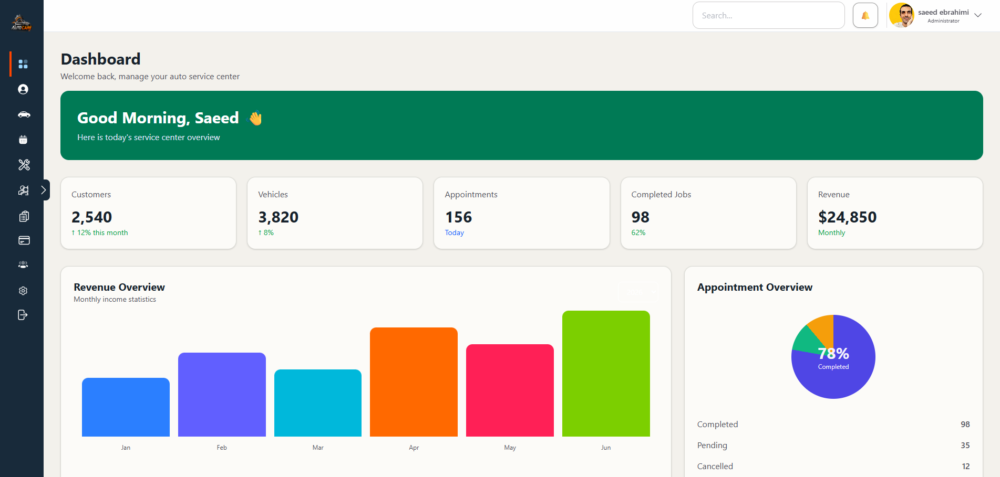

# AutoCare CMS Dashboard

<p align="center">
  
</p>

<p align="center">
  A responsive dashboard for managing automotive service operations, built with HTML, Tailwind CSS, JavaScript, and a Node.js/Express backend.
</p>

<p align="center">
  
</p>

AutoCare CMS is a web-based management system designed for automotive service businesses. It brings customer and vehicle records, appointments, services, employees, and other operational workflows into one dashboard.

The project emphasizes modular JavaScript, reusable UI components, API integration, role-based access control, and responsive design. It is under active development, so some modules and workflows may be incomplete or change over time.

## Contents

- [Features](#features)
- [Technology Stack](#technology-stack)
- [Architecture](#architecture)
- [Project Structure](#project-structure)
- [Getting Started](#getting-started)
- [Configuration Notes](#configuration-notes)
- [Project Status](#project-status)
- [Preview](#preview)
- [Author](#author)

## Features

### Dashboard and User Interface

- Responsive layouts for desktop and mobile screens.
- Sidebar navigation with desktop and mobile behavior.
- Light and dark themes.
- Reusable UI components, tables, forms, modals, dropdowns, and notifications.
- Modular JavaScript organized around pages, shared components, and utilities.

### Authentication and Access Control

- Login and authentication flow integrated with the backend.
- JWT-based authentication using an HTTP-only cookie.
- Role-based authorization for supported backend routes.
- Role-oriented workspaces for administrators, customers, receptionists, mechanics, and specialized service staff.
- User profile information and conditional profile-image loading.

### Customer and Vehicle Management

- Customer search and selection.
- Customer information management.
- Vehicle records stored separately and associated with customers.
- Vehicle selection during appointment creation.

### Appointment and Service Management

- Appointment creation integrated with the backend API.
- Customer, vehicle, and service selection.
- Appointment date and available time-slot selection.
- Availability checks based on scheduling rules and service requirements.
- Appointment records associated with relevant customers, vehicles, services, receptionists, and assigned technicians.
- Appointment statuses currently include `PENDING`, `CONFIRMED`, and `IN_PROGRESS`.
- Scheduling logic that accounts for technician roles and booking capacity.

### Notifications and Messaging

- Notification retrieval and read-status updates through the API.
- Unread-notification indicators.
- Conversation creation and message sending.
- Shared frontend functionality for conversation-related workflows.

### Additional Dashboard Modules

The dashboard also includes interfaces for employees, invoices, payments, users, and settings. Some modules may still be under development.

## Technology Stack

| Area | Technologies |
|---|---|
| Frontend | HTML, Tailwind CSS, JavaScript, Vite |
| Backend | Node.js, Express.js |
| Database and ODM | MongoDB, Mongoose |
| Development and Version Control | npm, Git, GitHub |

## Architecture

AutoCare CMS separates the frontend interface from backend business logic.

```text
AutoCare CMS
├── Frontend
│   ├── HTML pages
│   ├── Tailwind CSS
│   ├── JavaScript modules
│   ├── Shared UI components
│   └── API communication
└── Backend
    ├── Node.js and Express.js
    ├── Routes and controllers
    ├── Authentication and authorization
    ├── Application and business logic
    └── MongoDB and Mongoose
```

The frontend renders the dashboard, handles user interactions, performs client-side input validation, and communicates with the API.

The backend handles authentication, authorization, business rules, and persistent application data.

## Project Structure

The following tree provides a high-level overview of the project organization. Directory names and modules may change as development continues.

```text
Frontend/
├── pages/
│   ├── Admin/
│   │   ├── Dashboard/
│   │   ├── Appointment/
│   │   ├── Customers/
│   │   ├── Employees/
│   │   ├── Invoices/
│   │   ├── Payment/
│   │   ├── Services-page/
│   │   ├── Settings-page/
│   │   ├── Users/
│   │   └── Vehicles/
│   └── Components/
├── public/
│   ├── Components/
│   ├── fonts/
│   └── images/
├── scripts/
│   ├── components/
│   ├── funcs/
│   ├── models/
│   ├── pages/
│   ├── config.js
│   ├── index.js
│   └── register.js
├── shared/
├── src/
│   └── input.css
├── styles/
│   └── app.css
├── index.html
├── package.json
└── vite.config.js

Backend/
├── server.js
├── routes/
├── controllers/
├── models/
├── middleware/
└── ...
```

This is an illustrative structure rather than an exhaustive list of every file.

## Getting Started

These instructions describe the general local-development workflow. The exact commands and environment variables depend on the current frontend and backend configurations.

### Prerequisites

- Node.js and npm
- Git
- Access to a MongoDB instance for backend development

### 1. Clone the Repository

```bash
git clone https://github.com/s-ebrahimi-dev/cms-dashboard.git
cd cms-dashboard
```

### 2. Install Frontend Dependencies

Open a terminal in the frontend directory:

```bash
cd Frontend
npm install
```

### 3. Start the Frontend Development Server

```bash
npm run dev
```

Vite displays the local development URL in the terminal.

### 4. Build the Frontend

```bash
npm run build
```

Vite normally writes the production build to the `dist/` directory, unless a different output directory is configured.

### 5. Install Backend Dependencies

Open a separate terminal and navigate to the backend directory:

```bash
cd Backend
npm install
```

### 6. Configure and Start the Backend

Configure the required environment variables and database connection before starting the server.

If the backend defines a `dev` script in its `package.json`, run:

```bash
npm run dev
```

Use the scripts actually defined in the backend's `package.json` if they differ.

## Demo Accounts

You can explore the available dashboards using the demo accounts below.

| Dashboard | Role | Email | Password |
|---|---|---|---|
| Admin Dashboard | `ADMIN` | `s.ebrahimi.dev@gmail.com` | saeed4651&H |
| Receptionist Dashboard | `RECEPTIONIST` | `sepi@gmail.com` | saeed4651&H |
you can login as a "CUSTOMER" after registration on register panel.

**Notes:**
- Demo accounts are intended for evaluation and testing only.
- Do not use real personal information or production credentials.
- Demo access may be unavailable when the backend is offline or undergoing maintenance.
## Configuration Notes

- Configure the frontend to use the correct backend API origin for the current environment.
- Ensure that the frontend and backend ports, CORS settings, and authentication-cookie settings are compatible.
- Provide the database connection string and authentication secrets through environment variables.
- Never commit `.env` files, credentials, database connection strings, or JWT secrets to the repository.
- Check the current implementation before assuming that every dashboard module described in this README is complete.

## Project Status

**Status: In Development**

Core dashboard layout, responsive navigation, theme switching, modular frontend code, authentication integration, customer and vehicle API integration, service retrieval, appointment creation and availability checks, and notification/messaging workflows have been implemented to varying degrees.

### Current Development Priorities

- Refining dashboard modules and data tables.
- Improving filtering and customer-facing workflows.
- Expanding appointment and vehicle management.
- Improving consistency and usability across roles and screen sizes.

### Potential Future Improvements

- Dashboard analytics and interactive charts.
- Revenue, expense, and profit reporting.
- More advanced search and reporting.
- Further refinement of role-specific permissions.
- Additional interaction improvements and production-readiness work.

These future improvements are planned possibilities, not claims of completed functionality.

## Preview



If the preview does not appear, verify that the screenshot exists at the specified path and that its filename and capitalization match the repository.

## Author

**Saeed Ebrahimi**

Frontend developer focused on JavaScript, web application architecture, and practical full-stack development.

GitHub: [@s-ebrahimi-dev](https://github.com/s-ebrahimi-dev)

---

If you find this project interesting, feel free to explore the repository and follow its development.
